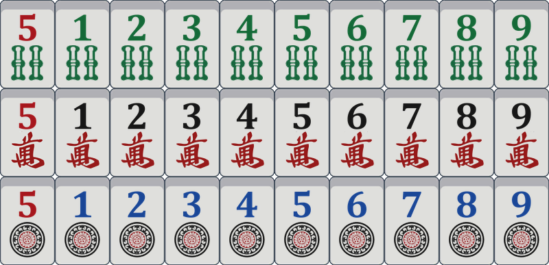
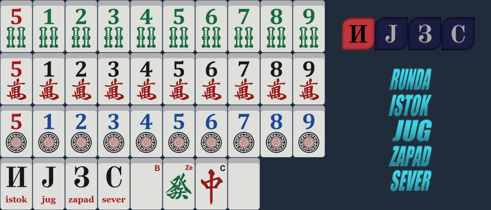

# mahjong-soul-number-tiles

Readable number tiles for **Mahjong Soul (Steam)**. The Chinese numerals on the number tiles become
big digits, so you can tell 1-9 apart at a glance:

- characters (man): black digit, red 萬 kept
- dots (pin): blue digit
- bamboo (sou): green digit
- red fives: red digit

Winds, dragons and the table centre are left exactly as the game ships them.

## Install

Download `MahjongSoul_NumberTiles.zip` from the [latest release](../../releases/latest), unzip it,
close Mahjong Soul, then:

- **Windows:** double-click `install.bat`. If the game isn't in the default Steam folder, it asks
  for the path to `Jantama_MahjongSoul_Data`.
- **Linux (Steam + Proton):** run `bash install.sh`. It finds the game in your Steam libraries
  (native, Flatpak or Snap Steam), or you can give the path:
  `bash install.sh "/path/to/Jantama_MahjongSoul_Data"`

In the game, use the **default** tile design (only that one is changed).

## Backups

- Install saves your own game files to `original_backup/` before replacing anything.
- The zip also ships untouched copies of the original files in `backup/`.

## Uninstall

Close the game and run `uninstall.bat` (Windows) or `bash uninstall.sh` (Linux). It restores from
`original_backup/`, or from `backup/` if that's missing. Steam → Properties → Installed Files →
*Verify integrity of game files* also puts everything back.

## Notes

- Built for the current Steam version. If the installer says **skip** for a file, your game has a
  different version of that file and that part won't change.
- A game update can undo it. Just run the installer again.
- Modifying game files is against the Mahjong Soul terms of service. Use at your own risk.

## Other versions

Serbian edition

Same number tiles, plus Serbian winds (И Ј З С with istok / jug / zapad / sever), B / Ze / C dragon
labels when "Show Tile Indexes" is on, and a Serbian table centre (RUNDA / ISTOK / JUG / ZAPAD / SEVER,
English game client only).
Download `MahjongSoul_NumberTiles_Serbian.zip` from the same release. It installs and uninstalls
the same way, and you can switch between the two versions freely.

